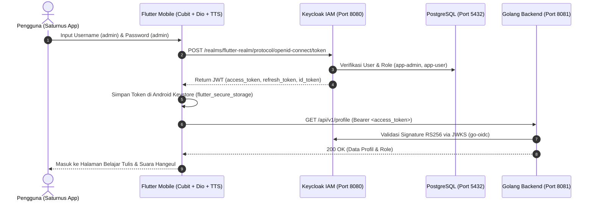

# Saturnus — Aplikasi Belajar Penulisan & Pelafalan Hangeul Korea (Flutter + Golang + Keycloak OIDC)

**Saturnus** adalah aplikasi mobile edukasi Bahasa Korea untuk mempelajari **Penulisan Aksara Hangeul (한글)**, **Pemecahan Penggabungan Huruf (Jamo / 자모)**, serta **Pelafalan Suara Bahasa Korea (`ko-KR`) secara Detail** yang terintegrasi dengan sistem keamanan **Keycloak (OAuth 2.0 / OIDC + PKCE)** dan **Backend REST API Golang**.

---

## Daftar Isi
1. [Fitur Utama Aplikasi](#1-fitur-utama-aplikasi)
2. [Arsitektur Sistem & Alur Otentikasi](#2-arsitektur-sistem--alur-otentikasi)
3. [Struktur Direktori Project](#3-struktur-direktori-project)
4. [Prasyarat & Instalasi](#4-prasyarat--instalasi)
5. [Cara Menjalankan (1-Click `.bat` Launcher)](#5-cara-menjalankan-1-click-bat-launcher)
6. [Kredensial Login & Layanan Docker](#6-kredensial-login--layanan-docker)
7. [Daftar Materi, Pemecahan Jamo & Panduan Suara Hangeul](#7-daftar-materi-pemecahan-jamo--panduan-suara-hangeul)
8. [Keamanan & `.gitignore`](#8-keamanan--gitignore)

---

## 1. Fitur Utama Aplikasi

### A. UI/UX Modern dengan Efek 3D Interaktif
- **3D Cyber Icosahedron & Orbital Rings**: Animasi 3D *real-time* (60 FPS) tepat di belakang judul **`WELCOME BACK / HELLO SIGN IN`** yang dapat diputar secara interaktif dengan sentuhan jari (*touch & drag*).
- **Otentikasi Keycloak (`flutter-realm`) & Google Sign-In**:
  - Mendukung login langsung menggunakan akun Keycloak (`admin` / `admin`) maupun alur OIDC Authorization Code + PKCE (`flutter_appauth`).
  - Dilengkapi vektor resmi Logo Google 4-warna pada tombol **Sign in with Google**.

### B. Modul Belajar Hangeul Korea & Kurikulum Khusus TOPIK I
Setelah login berhasil, pengguna masuk ke dashboard **Belajar Tulis & Suara Hangeul** yang memiliki **4 Menu Utama**:
1. **Angka (`일, 이, 삼...`)**: Angka Sino-Korea (`일` 1 s/d `십` 10) dan Angka Asli Korea (`하나` 1, `둘` 2).
2. **Vokal (`아, 야, 어...`)**: 10 Vokal Dasar (`아, 야, 어, 여, 오, 요, 우, 유, 으, 이`) dan Vokal Gabungan/Diftong (`와`).
3. **Latihan (`한글, 사랑...`)**: Kosakata & ungkapan penting sehari-hari (`한글`, `안녕`, `사랑`, `감사`, `친구`, `학교`).
4. **TOPIK I (`문법 & 어휘`)**: Modul khusus persiapan ujian **TOPIK I (Level 1–2)** yang terbagi menjadi:
   - **Sub-Tab 1: Tata Bahasa Dasar (`문법 / Grammar`)**:
     - **Partikel Dasar (`조사`)**: Subjek/Topik (`은/는`, `이/가`), Objek (`을/를`), Lokasi/Waktu (`에`, `에서`), Arah & Alat/Metode (`(으)로`), Penambahan & Kepemilikan (`도`, `의`), Penghubung Kata Benda (`와/과`, `(이)랑`, `하고`), serta Batasan (`부터`, `까지`, `만`).
     - **Akhiran Kalimat Formal & Informal**: Formal (`-ㅂ/습니다`, `-ㅂ/습니까?`), Informal Sopan (`-아/어요`), Bentuk Lampau (`-았/었어요`), Bentuk Masa Depan (`-(으)ㄹ 거예요`, `-(으)겠-`), serta Kalimat Ajakan, Perintah Sopan & Larangan (`-(으)ㅂ시다`, `-(으)세요`, `-지 마세요`).
     - **Kata Sambung & Konjungsi (`연결 어미`)**: Urutan/Alasan (`-아/어서`, `-(으)니까`), Pertentangan (`-지만`, `그런데`), Penjumlahan (`-고`), Syarat (`-(으)면`), Tujuan (`-(으)러 가다/오다`), Keinginan (`-고 싶다`), serta Kemampuan (`-(으)ㄹ 수 있다/없다`).
     - **Bentuk Kehormatan (`높임말`)**: Penanda kehormatan `-(으)시-` serta kosa kata honorifik (`드시다/잡수시다` makan, `주무시다` tidur, `말씀하시다` berbicara, `댁` rumah, `성함` nama, `연세` usia).
   - **Sub-Tab 2: Kosa Kata & Tema Sehari-hari (`어휘 / Vocabulary` — Target 1.500–2.000 Kata)**:
     - **Identitas & Perkenalan Diri**: Nama, kebangsaan (`나라/국적`), pekerjaan (`직업`), anggota keluarga (`가족`).
     - **Angka & Satuan Hitung**: Sino-Korea (tanggal, uang `원`, nomor telepon, menit `분`) & Asli Korea (jam `시`, usia, satuan benda `개, 명, 병, 권, 마리`).
     - **Waktu & Penanggalan**: Hari Senin–Minggu (`월요일~일요일`), kemarin (`어제`), hari ini (`오늘`), besok (`내일`), akhir pekan (`주말`).
     - **Lokasi & Arah**: Atas/bawah (`위/아래`), depan/belakang (`앞/뒤`), dalam/luar (`안/밖`), kiri/kanan (`왼쪽/오른쪽`), stasiun (`역`), bandara (`공항`), pasar (`시장`), bank (`은행`), kantor pos (`우체국`), rumah sakit (`병원`).
     - **Aktivitas Harian**: Belanja (`쇼핑`), memesan di restoran (`식당`), hobi/olahraga (`취미/운동`), cuaca & 4 musim (`날씨/계절`: `봄, 여름, 가을, 겨울`).
     - **Transportasi**: Kereta bawah tanah (`지하철`), bus (`버스`), taksi (`택시`), transfer jalur (`환승`), naik/turun (`타다/내리다`).

### C. Fitur Suara Pelafalan Korea (`ko-KR`) & Panduan Artikulasi Detail
Setiap huruf dan kata Hangeul dilengkapi fitur audio interaktif menggunakan **Native Android Korean Text-To-Speech (`Locale.KOREAN`)**:
- **Tombol `Dengar Suara`**: Memutar pelafalan asli Bahasa Korea dengan kecepatan normal (`0.88x`).
- **Tombol `Suara Lambat`**: Memutar pelafalan secara perlahan (`0.50x`) agar intonasi dan akhiran konsonan (*batchim*) terdengar jelas.
- **Tombol `Eja Per Huruf`**: Mengeja satu per satu komponen huruf penyusun (*Jamo*) secara berurutan lalu mengucapkan kata utuhnya.
- **Ketuk Kotak Jamo Individual**: Setiap kotak pecahan huruf (misal `[ㅎ]`, `[ㅏ]`, `[ㄴ]`) dapat diketuk langsung untuk mendengarkan nama huruf (*Giyeok, Nieun, Digeut, Rieul*, dst.) beserta bunyi fonetiknya.
- **Panduan Detail Artikulasi Mulut & Simbol IPA**: Menjelaskan posisi lidah, bukaan rahang, pembulatan bibir, serta hembusan napas untuk setiap huruf.

### D. Kanvas Latihan Goresan Tangan (`Coba Tulis`)
- Menyediakan fitur kanvas gambar (*drawing pad*) dengan bayangan *watermark* huruf Hangeul berukuran raksasa (`150pt`) agar pengguna dapat berlatih menggoreskan urutan penulisan huruf langsung dengan jari.

---

## 2. Arsitektur Sistem & Alur Otentikasi



---

## 3. Struktur Direktori Project

```text
loginkeyclock2/
├── .env.example                 # Template variabel environment (aman untuk Git)
├── .gitignore                   # Proteksi file kredensial, password, .env, dan build artifacts
├── docker-compose.yml           # Konfigurasi container PostgreSQL 16, Keycloak 24, dan pgAdmin 4
├── start-all.bat                # Script 1-klik: Menyalakan Docker, Keycloak, pgAdmin, Golang & Emulator
├── stop-all.bat                 # Script 1-klik: Menghentikan semua container Docker dengan aman
├── run-mobile.bat               # Script 1-klik: Menjalankan aplikasi Saturnus ke Android Emulator
│
├── backend/                     # Backend REST API Murni (Golang)
│   ├── go.mod
│   ├── cmd/api/main.go          # Entrypoint server HTTP Gin (:8081)
│   └── internal/
│       ├── auth/middleware.go   # Verifikasi JWT via JWKS Keycloak (go-oidc) & RBAC Middleware
│       └── handler/api_handler.go # Endpoint /public/ping, /profile, dan /admin/dashboard
│
└── mobile/                      # Aplikasi Mobile Flutter (Saturnus)
    ├── pubspec.yaml
    ├── android/
    │   └── app/src/main/
    │       ├── AndroidManifest.xml
    │       └── kotlin/.../MainActivity.kt  # Native MethodChannel Korean TextToSpeech (ko-KR)
    └── lib/
        ├── main.dart
        ├── core/
        │   ├── config/app_config.dart
        │   ├── network/dio_client.dart     # AuthInterceptor + Auto Refresh Token saat HTTP 401
        │   └── storage/secure_storage_service.dart
        └── features/
            ├── auth/
            │   ├── cubit/auth_cubit.dart
            │   ├── services/auth_service.dart
            │   └── presentation/
            │       ├── pages/sign_in_page.dart
            │       ├── pages/sign_up_page.dart
            │       └── widgets/auth_background_scaffold.dart  # Header 3D Interaktif
            └── hangeul/
                ├── data/hangeul_repository.dart               # Database Hangeul, Jamo & Detail Suara
                ├── services/hangeul_audio_service.dart        # Service Audio Pelafalan Korea
                └── presentation/pages/hangeul_home_page.dart  # UI Belajar Hangeul + Kanvas Tulis
```

---

## 4. Prasyarat & Instalasi

Pastikan perangkat Anda telah terinstal:
1. **Flutter SDK** (`>= 3.2.0`) & **Android Studio** (beserta Android Emulator `Pixel_8` / `emulator-5554`).
2. **Docker Desktop** (untuk menjalankan Keycloak, PostgreSQL, dan pgAdmin).
3. **Golang** (`>= 1.21`, untuk menjalankan backend REST API).

---

## 5. Cara Menjalankan (1-Click `.bat` Launcher)

### A. Menjalankan Aplikasi Mobile Flutter ke Emulator
Buka terminal di VS Code dan jalankan:
```powershell
& "d:\PC YUSUF\1. master\android studio\mobile\loginkeyclock2\run-mobile.bat"
```
Atau jika emulator sudah menyala, jalankan langsung dari folder `mobile`:
```powershell
cd mobile
flutter run -d emulator-5554 --no-enable-impeller
```
- Tekan **`r`** di terminal untuk *Hot Reload*.
- Tekan **`R`** di terminal untuk *Hot Restart*.

### B. Menjalankan Seluruh Infrastruktur (Docker + Keycloak + Postgres + pgAdmin + Golang)
```powershell
& "d:\PC YUSUF\1. master\android studio\mobile\loginkeyclock2\start-all.bat"
```

### C. Menghentikan Container Docker
```powershell
& "d:\PC YUSUF\1. master\android studio\mobile\loginkeyclock2\stop-all.bat"
```

---

## 6. Kredensial Login & Layanan Docker

| Layanan | URL / Port | Username / Email | Password | Keterangan |
| :--- | :--- | :--- | :--- | :--- |
| **Login Aplikasi Saturnus** | Di Aplikasi Mobile | `admin` | `admin` | Terdaftar di Keycloak (`flutter-realm`) |
| **Keycloak Admin Console** | http://localhost:8080 | `admin` | `admin` | Realm: `flutter-realm`, Client: `flutter-mobile-app` |
| **pgAdmin 4 Web UI** | http://localhost:5050 | `admin@admin.com` | `admin` | Host DB di dalam Docker: `postgres:5432` |
| **PostgreSQL Database** | `localhost:5432` | `keycloak_user` | `keycloak_password` | Nama Database: `keycloak_db` |
| **Golang REST API** | http://localhost:8081 | Bearer JWT Token | - | Endpoint `/api/v1/public/ping`, `/api/v1/profile` |

---

## 7. Daftar Materi, Pemecahan Jamo & Panduan Suara Hangeul

### 1. Menu Hangeul Angka
| Hangeul | Romaji & IPA | Arti | Pemecahan Huruf (Jamo) | Panduan Detail Suara |
| :---: | :---: | :--- | :--- | :--- |
| **일** | `il` `[il]` | Satu (1) | `ㅇ (-)` + `ㅣ (i)` + `ㄹ (l)` | Vokal "i" bersih ditutup ujung lidah di langit-langit depan ("L"). |
| **이** | `i` `[i]` | Dua (2) | `ㅇ (-)` + `ㅣ (i)` | Sudut bibir ditarik sedikit ke samping membunyikan "i" jernih. |
| **삼** | `sam` `[sam]` | Tiga (3) | `ㅅ (s)` + `ㅏ (a)` + `ㅁ (m)` | Desis "s" halus + vokal terbuka "a" + kedua bibir rapat ("m"). |
| **사** | `sa` `[sa]` | Empat (4) | `ㅅ (s)` + `ㅏ (a)` | Desis "s" ringan disambung vokal "a" terbuka. |
| **오** | `o` `[o]` | Lima (5) | `ㅇ (-)` + `ㅗ (o)` | Kedua bibir dibulatkan ke depan menghasilkan bunyi "o" bulat. |
| **육** | `yuk` `[juk̚]` | Enam (6) | `ㅇ (-)` + `ㅠ (yu)` + `ㄱ (k)` | Luncuran "yu" ditutup bunyi "k" tertahan di pangkal lidah. |
| **칠** | `chil` `[tɕʰil]` | Tujuh (7) | `ㅊ (ch)` + `ㅣ (i)` + `ㄹ (l)` | Bunyi "ch" dengan hembusan napas kuat + "i" + akhiran "l". |
| **팔** | `pal` `[pʰal]` | Delapan (8) | `ㅍ (p)` + `ㅏ (a)` + `ㄹ (l)` | Letupan bibir berhembus "pʰ" + vokal "a" + akhiran "l". |
| **구** | `gu` `[ku]` | Sembilan (9) | `ㄱ (g)` + `ㅜ (u)` | Konsonan lembut "g/k" diikuti bibir maju membentuk "u". |
| **십** | `sip` `[ɕip̚]` | Sepuluh (10) | `ㅅ (s/sh)` + `ㅣ (i)` + `ㅂ (p)` | Bunyi "sh" halus di depan "i", ditutup katupan bibir rapat ("p"). |
| **하나** | `ha-na` `[ha.na]` | Satu (Asli Korea) | `하 (ㅎ+ㅏ)` + `나 (ㄴ+ㅏ)` | Hembusan "ha" ringan diikuti sengau "na". |
| **둘** | `dul` `[tul]` | Dua (Asli Korea) | `ㄷ (d)` + `ㅜ (u)` + `ㄹ (l)` | Ujung lidah di gigi atas ("d") + vokal "u" + akhiran "l". |

### 2. Menu Hangeul Vokal
| Hangeul | Romaji & IPA | Pemecahan Huruf | Panduan Detail Artikulasi Suara |
| :---: | :---: | :--- | :--- |
| **아** | `a` `[a]` | `ㅇ (-)` + `ㅏ (a)` | Mulut terbuka natural mengeluarkan bunyi "a" terang. |
| **야** | `ya` `[ja]` | `ㅇ (-)` + `ㅑ (ya)` | Luncuran cepat dari posisi "i" ke vokal terbuka "a" ("ya"). |
| **어** | `eo` `[ʌ]` | `ㅇ (-)` + `ㅓ (eo)` | Rahang agak terbuka dan lidah ditarik ke belakang **tanpa** membulatkan bibir. |
| **여** | `yeo` `[jʌ]` | `ㅇ (-)` + `ㅕ (yeo)` | Luncuran "y" menuju vokal terbuka "eo". |
| **오** | `o` `[o]` | `ㅇ (-)` + `ㅗ (o)` | Bibir **wajib** membulat ke depan menghasilkan bunyi "o" bulat. |
| **요** | `yo` `[jo]` | `ㅇ (-)` + `ㅛ (yo)` | Luncuran "y" dengan bibir langsung membulat ("yo"). |
| **우** | `u` `[u]` | `ㅇ (-)` + `ㅜ (u)` | Bibir dimajukan membentuk lingkaran kecil menghasilkan bunyi "u". |
| **유** | `yu` `[ju]` | `ㅇ (-)` + `ㅠ (yu)` | Luncuran "y" menuju vokal bulat "u" ("yu"). |
| **으** | `eu` `[ɯ]` | `ㅇ (-)` + `ㅡ (eu)` | Bibir ditarik datar ke samping sambil mengucapkan "e" pepet (seperti kata "enam"). |
| **이** | `i` `[i]` | `ㅇ (-)` + `ㅣ (i)` | Bagian depan lidah mendekati langit-langit menghasilkan bunyi "i". |
| **와** | `wa` `[wa]` | `ㅇ (-)` + `ㅗ (o)` + `ㅏ (a)` | Vokal bulat "o" dan vokal terbuka "a" diucapkan menyatu menjadi "wa". |

### 3. Menu Latihan Lainnya
- **한글 (`han-geul`)**: `한 (ㅎ+ㅏ+ㄴ)` + `글 (ㄱ+ㅡ+ㄹ)` — Aksara Korea.
- **안녕 (`an-nyeong`)**: `안 (ㅇ+ㅏ+ㄴ)` + `녕 (ㄴ+ㅕ+ㅇ)` — Halo / Hai (menunjukkan perbedaan `ㅇ` hening di awal vs `ㅇ` berbunyi `"ng"` di akhir).
- **사랑 (`sa-rang`)**: `사 (ㅅ+ㅏ)` + `랑 (ㄹ+ㅏ+ㅇ)` — Cinta / Kasih Sayang.
- **감사 (`gam-sa`)**: `감 (ㄱ+ㅏ+ㅁ)` + `사 (ㅅ+ㅏ)` — Terima Kasih.
- **친구 (`chin-gu`)**: `친 (ㅊ+ㅣ+ㄴ)` + `구 (ㄱ+ㅜ)` — Teman / Sahabat.
- **학교 (`hak-gyo`)**: `학 (ㅎ+ㅏ+ㄱ)` + `교 (ㄱ+ㅛ)` — Sekolah.

---

## 8. Keamanan & `.gitignore`

Seluruh file yang mengandung username, password, dan kunci rahasia telah dimasukkan ke dalam `.gitignore` agar tidak ikut ter-commit ke repositori publik:
- `.env` dan seluruh file `*.env` (kecuali `.env.example`).
- `docker-compose.yml`, `start-all.bat`, `stop-all.bat`, dan `run-mobile.bat`.
- File keystore Android (`*.jks`, `*.keystore`, `key.properties`) dan volume database lokal (`postgres_data/`, `pgadmin_data/`).
